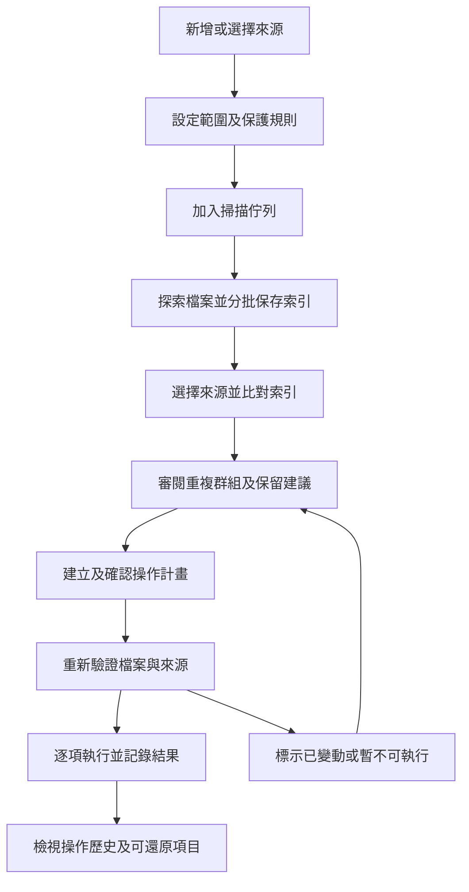

# 多來源掃描與持續索引工作流程

## Metadata

| 欄位 | 值 |
|------|----|
| Spec | SPEC-001 |
| Status | Draft |
| Owner | 待指定 |
| Reviewer | 產品負責人與後續設計人員 |
| 建立與更新日期 | 2026-10-23 |
| Related Plan | [PLAN-001](../plans/PLAN-001-batch-consolidation-workbench.md)（Draft，待相關 ADR 決定後開始） |

## 摘要

讓使用者透過 GUI 將多個資料夾分次排入掃描工作，累積持久索引，審閱跨來源的重複項目，再以可確認、可追蹤的計畫整理檔案。詳細產品需求以 [requirements.md](../requirements.md) 為準；本規格補充流程、狀態及驗收情境。

## 目標

- 已掃描的來源能跨次使用，不再依賴同一批掃描或單一 JSON 結果檔。
- 掃描、索引查詢、檔案審閱及操作執行有明確邊界。
- 來源離線、掃描中斷及檔案變動都能被看見並妥善處理。
- 使用者審閱實際變更後才執行；已執行的結果能逐項追蹤。

## 範圍外

本階段不定案 layout、資料庫 schema、UI 框架、引擎介接或安裝程式；不開始功能實作。影片相似度、背景監控及進階連結替換可另立規格。不得把同名、感知雜湊相近或 metadata 分數高，直接當成可安全移除的依據。

## 使用者故事

- US-001：今天掃描照片庫，日後加入備份硬碟，仍能找到兩者之間的重複項目。
- US-002：掃描中可以加入下一個來源，暫停目前工作，重新開啟程式後繼續處理。
- US-003：能看懂每組檔案的差異、保留建議及保護條件，再確認整理清單。
- US-004：部分操作失敗時，能知道已成功的項目，並對可還原項目個別處理。

## 功能需求對照

| 流程 | 對應需求 |
|------|----------|
| 來源管理與工作建立 | FR-001、FR-002 |
| 索引累積、更新與恢復 | FR-003、FR-004 |
| 選擇比較範圍與審閱 | FR-005、FR-006 |
| 保留建議與待執行計畫 | FR-007、FR-008 |
| 執行、歷史與還原 | FR-008、FR-009 |
| GUI 啟動與資料位置 | FR-010 |

品質與安全要求沿用產品需求文件。第一個端到端版本先處理經內容確認的重複檔案；相似影像候選保留獨立狀態與後續擴充入口。

## 流程概觀

已保存的索引可以在掃描尚未全部完成時供查詢，但必須標示結果為部分範圍。掃描完成不會自動整理檔案；執行計畫也不會自動清空回收區。

## 來源與索引

來源記錄應能表達使用者名稱、識別資訊、目前路徑、可連線狀態、排除／保護規則及最近掃描結果。不能只依磁碟代號判定同一顆硬碟；重新指定路徑時需要核對來源與索引的關係。

移除來源只改變後續追蹤與比較範圍，不刪除原始檔案。清除既有索引需另行明示；相關掃描工作停止或取消，待執行計畫轉為需更新。既有操作歷史及還原紀錄不能因移除來源而一併遺失。

完整索引包含所有已掃描檔案，不只保存當時被判為重複的項目。每筆需能追溯來源、檔案屬性、指紋種類與版本、最近觀察時間，以及所屬掃描的完成範圍。這是資料責任定義，並非已選定的資料表設計。

新增或改動的檔案需要更新指紋；未變動項目可以沿用有效紀錄。中斷、取消、排除條件變動及權限不足造成的未觀察項目，不能一律標記為已刪除。只有完成相應範圍的有效檢查，才能確認某筆檔案已缺失。

## 掃描工作與恢復

每個工作保存來源、範圍與設定快照、建立時間、狀態、階段、計數、檢查點及錯誤摘要。執行中修改來源設定，不應默默改變既有工作的語意；新設定形成新的更新工作。

第一階段預設一個來源掃描工作執行、其餘排隊。是否開放多工作同時執行及資源限制，留待效能評估，不由 layout 自行承諾。

| 狀態 | 使用者看到的意義 | 可採取動作 |
|------|------------------|------------|
| 等候中 | 已保存，尚未開始 | 改順序、取消 |
| 執行中 | 顯示探索、計算指紋或保存索引等目前階段 | 要求暫停或取消 |
| 正在暫停 | 正在完成可安全保存的目前單位 | 等待保存，仍可瀏覽其他資訊 |
| 已暫停 | 已保存進度，不再安排新檔案 | 繼續、取消 |
| 等待來源 | 來源離線或暫時無法讀取 | 重新連接、重試、取消 |
| 中斷待處理 | 上次未正常結束，需要確認恢復方式 | 繼續掃描、重新掃描、取消 |
| 取消中 | 停止安排新工作並保存已完成內容 | 等待取消完成 |
| 已取消 | 未完成的範圍停止；已保存索引仍存在 | 建立新工作或檢視部分結果 |
| 完成 | 本次範圍處理完畢，列出成功、略過與錯誤數 | 查看結果、重掃失敗項目 |
| 失敗 | 工作無法繼續，保存原因及已完成範圍 | 修正問題後重試或重新建立 |

每個檔案的錯誤不必使整個來源失敗。完成但包含錯誤的工作，需有明顯提示；不能只顯示綠色成功而隱藏未讀取的範圍。

暫停及中斷恢復允許重新處理尚未提交的單位，不承諾從檔案內的某個 byte 精確續傳。恢復後也要驗證已保存紀錄的有效性。程式重新啟動時，不可自動恢復任何破壞性檔案操作。

## 比較範圍與結果可信度

使用者選擇一個或多個來源，可以查來源內、來源之間或選定集合。不同來源分次完成掃描後，仍可用同一索引集合比較。

結果分類契約如下。第一階段只啟用內容相同的流程；其他類型在各自功能完成後啟用，不能沿用內容相同的處理語意。

- **內容相同**：具有可追溯的內容指紋與驗證依據，可以進入內容重複檔的整理流程。
- **相似影像候選**：有相似度條件與分數，需要人工對照，不等於內容相同。
- **同名候選**：用來找可能相關的版本；檔名或大小相同不能證明內容相同。

每組需顯示來源、最近觀察時間、完整／部分掃描與目前可讀取狀態。尚未完成的掃描可以改變結果；進入待執行計畫時需固定所審閱的版本，之後的變更使相關操作轉為待更新。

## 審閱與保留建議

檔案對照須能看到完整路徑、檔案大小、來源、建立／修改日期，以及可取得的拍攝時間、尺寸與相機資訊。缺少 metadata 與預覽失敗都需要明確顯示，不能推斷成較差或不重要的檔案。

使用者可以接受或調整保留建議、保留多份、略過整組，以及查看建議理由。受保護來源是限制條件；來源優先序、日期與大小是建議規則，兩者不能混為一談。套用規則只更新建議與計畫，不執行檔案操作。

## 操作計畫與執行

操作計畫列出保留檔、處理檔、動作、回收／隔離目的地、預估影響與不可執行的原因。使用者可以在執行前移除項目或返回審閱。任何新加入的項目都不能沿用先前已給出的執行確認。

執行前重新檢查相關來源、待處理檔、保留檔、保護規則及判定證據。既有索引只是先前的觀察，不能單獨授權對目前檔案動作。驗證策略與檔案操作競態的處理方式需在實作計畫中定義及測試。

每筆操作保存驗證結果、執行結果、時間與失敗原因。中途失敗不代表整批已回滾；成功項目不可因重試而重複執行。使用者取消時，停止尚未開始的操作並保留已完成紀錄。

「估計可回收空間」與「已釋放空間」需分開呈現。回收／隔離可能仍佔用原磁碟或另一磁碟的空間；有多份保留、hardlink 或部分失敗時，不可直接使用整組重複大小當成已回收數字。

## 歷史與還原

按執行批次與單筆檔案顯示成功、失敗、略過、待處理與可還原狀態。只有仍存在的回收內容及足夠的操作紀錄，才能提供還原。

還原遇到原路徑已存在、來源離線、空間不足或回收內容已清除時，應顯示原因及可選處理方式。不得覆寫原位置的新檔案，也不得把清空回收區後的操作顯示為仍可撤回。

## 驗收情境

以下是後續實作的驗收草案，不是已執行的測試結果。

| 編號 | 情境與預期結果 |
|------|----------------|
| AC-01 | 先掃 A、關閉程式，再加入 B；能找出 A 與 B 的內容重複，A 中非重複檔的索引仍存在。 |
| AC-02 | A 掃描時新增 B 並調整待執行順序；A 不重啟，新增工作保存為等候狀態。 |
| AC-03 | 暫停後重啟程式再繼續；已提交索引保留，未提交單位可重做，沒有重複檔案紀錄。 |
| AC-04 | 外接硬碟拔除；工作顯示等待來源，舊索引仍可查詢，檔案不被誤標為已刪除或可立即整理。 |
| AC-05 | 掃描遇到無權限、排除路徑或損壞檔；顯示未涵蓋範圍及錯誤，其他檔案可繼續處理。 |
| AC-06 | 來源重疊時，同一路徑不重複建立紀錄；既有 hardlink 能表達多個路徑共用實體檔案，空間不重複計算。 |
| AC-07 | 套用保留建議並保留多份；原始檔未變動，計畫遵守保護規則且至少留一份有效檔案。 |
| AC-08 | 確認計畫前後有檔案改動、保留檔移走或來源離線；相關操作被阻擋或略過，顯示需更新的原因。 |
| AC-09 | 執行部分成功後失敗或中斷；逐項紀錄可查，重試不重複處理成功項目，也不宣稱整批回滾。 |
| AC-10 | 還原時原路徑出現同名新檔；新檔不被覆寫，使用者可處理衝突或取消該筆還原。 |
| AC-11 | 後續啟用相似圖片或同名候選時，類型清楚可辨，不會直接併入內容相同的自動整理計畫。 |
| AC-12 | 大量群組、長路徑與缺少預覽同時存在；仍能操作、定位來源及辨識保留目標，效能依事先定義的資料集量測。 |

## 相依工作與待決問題

需先確認 [產品需求的 D-01 至 D-06](../requirements.md#待決策項目)，再決定資料庫、引擎、恢復策略及回收政策。現有 C#／WPF、JSON 儲存及快取服務是現況，不直接當成下一版的完成方案。

後續實作計畫需涵蓋來源身份、索引遷移、檢查點、指紋有效性、操作競態、回收與還原衝突、測試資料及效能量測。CI 維持停用；重新啟用需要另行指示。

## 參考

- [產品需求](../requirements.md)
- [GUI 設計交接](../ux-design-brief.md)
- [現有掃描流程](../../src/Gui/ViewModels/ScanViewModel.cs)
- [現有結果操作](../../src/Gui/ViewModels/ResultsViewModel.cs)
- [現有 JSON 儲存](../../src/Core/Services/JsonScanResultStore.cs)
- [測試現況](../testing.md)
